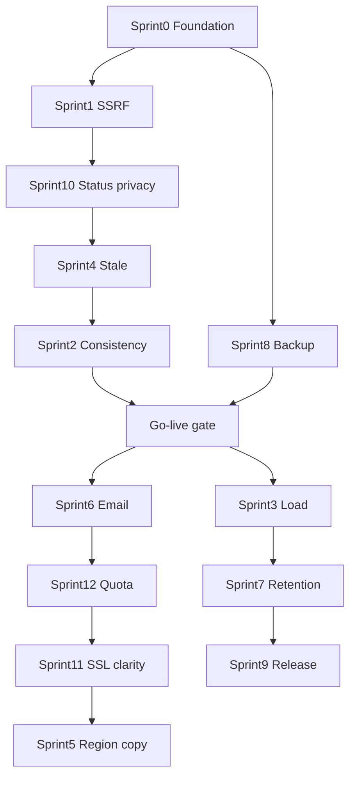

# MONI — sprint map (hardening + go-live)

> **Synced** từ [`upgrade_hardening_phase_plan.md`](upgrade_hardening_phase_plan.md) §4–§5.  
> Đổi status sprint → cập nhật **cả** file này và macro plan trong cùng phiên (lessonlearn A1).

## Bảng map

| Phase | Sprint | Folder | Mục tiêu shippable | Depends | Status |
|-------|--------|--------|--------------------|---------|--------|
| H0 | 0 | [`Moni_Sprint0`](../../Implement_docs/Moni_Sprint0/) | Runtime modes + VPS prep | — | **DONE** 2026-10-29 (VPS ticks Pending) |
| H1 | 1 | [`Moni_Sprint1`](../../Implement_docs/Moni_Sprint1/) | SSRF redirect/body/DNS re-check | 0 partial | **DONE** 2026-10-27 |
| H1 | 2 | [`Moni_Sprint2`](../../Implement_docs/Moni_Sprint2/) | Consistency stale + 1 open incident | — | **DONE** 2026-10-27 |
| H2 | 3 | [`Moni_Sprint3`](../../Implement_docs/Moni_Sprint3/) | Celery/Redis load + chaos prove | after GL | **OPEN** |
| H1 | 4 | [`Moni_Sprint4`](../../Implement_docs/Moni_Sprint4/) | Stale vs down freshness | — | **DONE** 2026-10-29 |
| H1 | 5 | [`Moni_Sprint5`](../../Implement_docs/Moni_Sprint5/) | Region honesty (label ≠ egress); real geo → DEF-REGION | — | **OPEN** |
| H1 | 6 | [`Moni_Sprint6`](../../Implement_docs/Moni_Sprint6/) | Email outbox + admin mỏng | 2 preferred | **DONE** 2026-10-29 |
| H2 | 7 | [`Moni_Sprint7`](../../Implement_docs/Moni_Sprint7/) | Retention job | after data | **OPEN** |
| H0 | 8 | [`Moni_Sprint8`](../../Implement_docs/Moni_Sprint8/) | Backup restore drill | 0 | **DONE** 2026-10-29 |
| H2 | 9 | [`Moni_Sprint9`](../../Implement_docs/Moni_Sprint9/) | Release/rollback drill | after CI on new host | **OPEN** |
| H1 | 10 | [`Moni_Sprint10`](../../Implement_docs/Moni_Sprint10/) | Status page privacy | — | **DONE** 2026-10-27 |
| H1 | 11 | [`Moni_Sprint11`](../../Implement_docs/Moni_Sprint11/) | SSL/domain clarity | — | **OPEN** |
| H1 | 12 | [`Moni_Sprint12`](../../Implement_docs/Moni_Sprint12/) | Quota / abuse caps | — | **OPEN** |

## Hard rules

1. Không implement trước Plan #1 + Plan #2 sprint **CHỐT**.  
2. Không mở lại multi-region consensus (Plan B). Real egress = DEF-REGION (§2.3), không VPN-in-process.  
3. Không trỏ GitHub deploy tới `pinvps01` trước go-live gate.  
4. Cleanup test scoped — cấm delete không `WHERE`.
