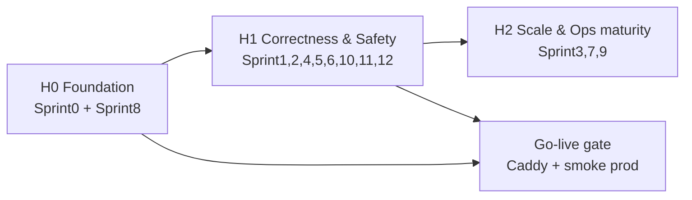

# MONI — Upgrade & Hardening Phase Plan (macro)

> **Vai trò:** Explore / khả thi / phase map + sprint map cấp cao cho đợt hoàn thiện + go-live MONI.  
> **Không thay** BR/devplan chi tiết từng sprint (nằm ở `docs/Implement_docs/Moni_SprintN/`).  
> **Rule thực thi:** [`../../Implement_docs/lessonlearn.md`](../../Implement_docs/lessonlearn.md) — áp dụng **hết** (A–N, đặc biệt M1–M6, B7 plan-before-code, B8 council, J5 tự log).  
> **Ngày lập:** 2026-10-27 · **Trạng thái Plan #0 (macro):** DRAFT chờ CHỐT stakeholder  
> **Liên quan:** [`../../../server-context.md`](../../../server-context.md) · [`../../../planning-docs/GO-LIVE-PINVPS01.md`](../../../planning-docs/GO-LIVE-PINVPS01.md) · [`../../../upgrade_planning_docs_1`](../../../upgrade_planning_docs_1)

---

## 0) Một câu định hướng

Hoàn thiện MONI theo hướng **đúng nghĩa sản phẩm giám sát** (security probe, nhất quán trạng thái, honesty của dữ liệu, ops go-live trên VPS dùng chung), rồi **ship production** — không mở lại multi-region consensus, không claim scale 1000 monitor trước khi đo trên máy thật.

---

## 1) Context sản phẩm & codebase (baseline)

### 1.1 Sản phẩm

| Hạng mục | Giá trị |
|----------|---------|
| Tên | MONI |
| Loại | Uptime monitoring + incident + email alert |
| Stack | Vue 3 · FastAPI · PostgreSQL · Redis · Celery · Docker Compose |
| Auth | JWT access/refresh · email verify · Google OAuth |
| Live trước đây | Từng deploy trên VPS khác (`/opt/moni/monitest_1`); **không** còn là máy go-live hiện tại |
| Go-live đích | VPS `pinvps01` dùng chung với app `monitest.top` tại `/opt/pinterest` (Caddy) |

### 1.2 Đã ship (upgrade cycle trước — không làm lại)

- HTTP monitor CRUD, run-check, scheduler due-only, skip `CHECKING`
- `accepted_status_codes`, alert cooldown / still-down / max reminders
- Status pages private/public + maintenance notes
- SSL/domain expiry + threshold 30/14/7/1 + dedupe (semantics còn cần làm rõ — Sprint11)
- `probe_regions` + `monitor_regions` + **`active_region` only** (resource-saving)
- Runtime health heartbeat + queue profile; dashboard không block runtime
- CI: GHCR + SSH deploy + migrate qua live `api` container
- Local scripts: restart/check/smoke gate; local API mặc định **8011**

### 1.3 Explicit OUT (toàn đợt — ghi để không bị hỏi lại)

| OUT | Lý do |
|-----|--------|
| TCP/ICMP execution đầy đủ | Schema có; HTTP là type đã ship |
| Multi-region consensus / fanout N checks (phương án B) | Đã deprecate vì tải; giữ phương án A |
| Kafka / realtime WebSocket | Polling đủ MVP |
| Slack/webhook alerts | Email only |
| Multi-tenant org / billing plans | Ngoài scope |
| Claim “1000 monitors” không kèm số đo VPS | Chỉ prove N khớp `pinvps01` |
| Partition Postgres ngay | Chờ retention + số liệu thật |
| Pin-IP SSRF transport hoàn chỉnh | Phase sau redirect-hardening |

### 1.4 Runtime modes (chốt nguyên tắc chuyển trạng thái)

| Mode | App processes | DB/Redis host | Port API | Khi nào |
|------|---------------|---------------|----------|---------|
| **local-process** | uvicorn + celery + vite | `localhost` | **8011** | Default nâng cấp (không build image app) |
| **local-docker** | full compose | `postgres`/`redis` | **8010** | Prove gần prod khi đủ ổ |
| **prod** | compose trên VPS | `postgres`/`redis` | loopback **8010** + Caddy | Go-live |

**Rule:** đổi mode = đổi file env active + lệnh start; **không** sửa code.  
Chi tiết hygiene (`.env.local` / `.env.docker` / port docs) = **Moni_Sprint0**.

---

## 2) System survey (codebase vs mục tiêu)

Khảo sát 12 hạng mục hardening. **Status SSOT cập nhật 2026-10-29** (S1/S2/S4/S10 CLOSED).

### 2.0 Trạng thái wave (DONE vs còn lại)

| ID | Chủ đề | Status | Sprint / ghi chú |
|----|--------|--------|------------------|
| S0 | Mode + go-live host | **DONE** 2026-10-29 | VPS swap/`/opt/moni`/Caddy ticks = Pending → GL |
| S1 | SSRF | **DONE** 2026-10-27 | T2 còn: pin-IP + egress FW |
| S2 | Consistency | **DONE** 2026-10-27 | Outbox email → S6 |
| S3 | Celery load / chaos | **OPEN** | Prefetch/`acks_late` đã siết; chưa đo N |
| S4 | Stale vs DOWN | **DONE** 2026-10-29 | T2: external watchdog |
| S5 | Multi-region | **OPEN** + **GAP** | Label Plan A; **egress thực tế = một máy** (§2.3) |
| S6 | Email outbox | **DONE** 2026-10-29 | `email_outbox` + admin UI mỏng; migrate+seed ops |
| S7 | Retention | **OPEN** | — |
| S8 | Backup/restore | **DONE** 2026-10-29 | Drill local + scripts; off-host VPS Pending |
| S9 | Release/rollback | **OPEN** | — |
| S10 | Status privacy | **DONE** 2026-10-27 | T2: CAPTCHA |
| S11 | SSL/domain clarity | **OPEN** | — |
| S12 | Quota / abuse | **OPEN** | Đã có RL một phần; thiếu max monitors / min interval |

**Chuỗi còn lại:** go-live gate (VPS Pending) → S12 → S11 → S5 (honesty) → S3 / S7 / S9.

Survey lúc mở wave (2026-10-27) — giữ audit:

| ID | Đã có (lúc survey) | Còn thiếu (lúc survey) | Sprint |
|----|--------------------|------------------------|--------|
| S0 | Compose prod, go-live doc, scripts | Port drift; Caddy; swap; hostname | Sprint0 |
| S1 | Validate create + DNS | Redirect/body/userinfo | Sprint1 |
| S2 | Entities tách; email delay | Stale overwrite; unique OPEN | Sprint2 |
| S3 | Prefetch; queue profile | Đo N; chaos | Sprint3 |
| S4 | Runtime DEGRADED | Freshness UI/API | Sprint4 |
| S5 | active_region only | Copy honesty | Sprint5 |
| S6 | AlertEvent sau send | Outbox pending | Sprint6 |
| S7 | — | Policy/job | Sprint7 |
| S8 | pg_dump CI | Restore drill | Sprint8 |
| S9 | SHA tags | Rollback drill | Sprint9 |
| S10 | Ownership; private 404 | Public url | Sprint10 |
| S11 | Expiry worker | Message taxonomy | Sprint11 |
| S12 | Auth RL; run-check throttle | Max monitors; min interval | Sprint12 |

### 2.1 VPS `pinvps01` (từ `server-context.md`)

| Hạng mục | Giá trị |
|----------|---------|
| CPU / RAM | 2 / 3.8 GiB · **no swap** |
| RAM available lúc đo | ~1.9 GiB |
| Disk free | ~19 GB |
| Proxy | **Caddy** (không Nginx host như runbook x3mphim) |
| App đang sống | `monitest.top` → `/opt/pinterest` · cổng host `8080` |
| MONI ports dự kiến | `127.0.0.1:8010`, `127.0.0.1:4173` — không trùng |
| Ước lượng RAM 2 app | ~2.5–3.0 GiB → cần **swap** trước start MONI |

### 2.2 Rủi ro ưu tiên (Type1-style — đã tồn tại trên code ship)

| ID | Issue | Gắn sprint |
|----|-------|------------|
| T1-M01 | Redirect SSRF | Sprint1 |
| T1-M02 | Public status page lộ URL | Sprint10 |
| T1-M03 | Stale UP misleading | Sprint4 |
| T1-M04 | Concurrent incident / stale overwrite | Sprint2 |

Type2 / defer: xem [`security_followups_type1_type2.md`](security_followups_type1_type2.md) và [`deferred_and_out_of_scope_backlog.md`](deferred_and_out_of_scope_backlog.md).

### 2.3 GAP lớn — Region / egress thực tế (không phải “VPN library”)

**Hiện trạng:** `probe_regions` / `active_region` là **nhãn lịch sử + chọn region chạy**. Worker Celery (local hoặc VPS) vẫn egress từ **một IP máy đang chạy** — không phải từ Tokyo/Frankfurt/… như UI gợi ý. Đây là **honesty gap** lớn hơn copy UI (S5 Plan A).

**Không có** thư viện Python/in-process đóng vai “VPN đa vùng” cho HTTP check: VPN/proxy là **hạ tầng mạng** (tunnel, SOCKS/HTTP proxy, worker remote), không phải dependency app.

| Hướng | Cách làm | Pros | Cons | Ghi chú MONI |
|-------|----------|------|------|--------------|
| **A. Honesty only** (S5 hiện tại) | UI/API: “probed from `<host>` · label `active_region`”; docs Plan A | Rẻ, đúng sự thật | Không có geo diversity thật | **Ship trước** trong wave |
| **B. Worker per region** | Celery worker (hoặc agent) trên VPS/VM/cloud mỗi vùng; queue theo `region` | Egress IP thật theo vùng; kiểm soát SSRF/egress FW | Chi phí máy + deploy; ops | **Khuyến nghị** nếu cần real multi-region |
| **C. Geo HTTP/SOCKS proxy** | Proxy thương mại (Bright Data, Oxylabs, IPRoyal, …) hoặc self-host TinyProxy/3proxy + WireGuard hop | Nhanh gắn 1 worker | Uy tín/SSRF phức tạp; phụ thuộc vendor; latency | Chỉ proxy **đã whitelist**; vẫn apply SSRF |
| **D. VPN/tunnel hop** | WireGuard/OpenVPN/Tailscale exit node / cloud VPN per region; worker route qua interface | IP exit theo vùng | Không phải lib app; routing OS; 1 tunnel ≠ N vùng song song dễ | Dùng như **egress path** cho worker B |
| **E. SaaS check API** | Gọi API check ngoài (Pingdom-style, Checkly, …) | Geo sẵn | Vendor lock; mất kiểm soát probe | OUT trừ đánh giá sau |

**Chốt tạm (2026-10-29):** wave hardening **không** bắt buộc B/C/D trước go-live. S5 = honesty. Real egress = **DEF-REGION**.

**Hướng real egress đã nghiêng (2026-10-29, chưa implement):** cơ chế **`region → egress`** (pluggable):

- Cùng máy với worker / VPS đang có → **`direct`** (không bắt buộc proxy; proxy local không tạo region mới).  
- Region khác vị trí worker → `Celery → HTTP/SOCKS proxy (hoặc worker remote) → target`.  
- VPS hiện có = **một** region thật đầu tiên; thêm vùng = thêm máy/proxy **đúng địa lý**.  
- **Cấm** public free list. Latency qua proxy = tổng hop (không tách sạch).  
- **Serverless / PaaS:** Lambda pin region rõ hơn Workers; Fly/Render/Koyeb free **không** đủ multi-region always-on ổn.  
- **Go-live (constraint không thẻ QT):** **một** region `direct` (VPS); S5 chỉ offer region đó.  
- **Post-ready / DEF-REGION (CHỐT D10):** hướng **AWS Lambda per region** — implement đủ trong repo (adapter + config + tests + deploy template); runtime **inactive** đến khi env có `REGION_EGRESS_*=lambda:...` + function đã deploy. Workers/Render/proxy **không** là path chính.

---

## 3) Mục tiêu business của đợt

1. Người vận hành **tin được** trạng thái monitor (không nhầm worker chết = site down; không lộ internal URL).  
2. Không dùng MONI làm proxy tấn mạng nội bộ (SSRF).  
3. Trạng thái/incident **nhất quán** dưới race và task retry.  
4. Go-live trên `pinvps01` **không phá** app `monitest.top`.  
5. Tài liệu và quy trình sprint **bám lessonlearn** (plan → code → prove-done → distill).

**Không** phải mục tiêu: viết lại product; mở enterprise multi-region; tối ưu marketing SEO.

---

## 4) Phase map (vĩ mô)

| Phase | Tên | Sprint | Mục tiêu shippable phase |
|-------|-----|--------|---------------------------|
| **H0** | Foundation & ops | 0, 8 | Mode env rõ; VPS sẵn (swap, `/opt/moni`); backup/restore có chứng từ |
| **H1** | Correctness & safety | 1, 2, 4, 5, 6, 10, 11, 12 | SSRF/redirect; consistency; stale; region honesty; outbox mỏng; status privacy; SSL clarity; quota |
| **H2** | Prove & harden scale | 3, 7, 9 | Load/chaos có số; retention; release/rollback drill |
| **GL** | Go-live | sau H0 tối thiểu + P0 của H1 | Domain MONI sống sau Caddy; smoke prod |

**Thứ tự thực thi khuyến nghị (cập nhật 2026-10-29 — P0 H1 một phần DONE):**

1. ~~Sprint1 → Sprint10 → Sprint4 → Sprint2~~ **DONE**  
2. **Sprint0** (bắt buộc trước GL) + **Sprint8** (backup drill)  
3. **Go-live gate** (hostname + Caddy + smoke)  
4. Sprint6 → Sprint12 → Sprint11 → Sprint5 (honesty; real egress → DEF-REGION)  
5. Sprint3 → Sprint7 → Sprint9  

Hard rule lessonlearn: **không** mở Sprint N+1 khi Sprint đang làm còn `[ ]` chưa Pending hợp lệ.

---

## 5) Sprint map chi tiết

| Sprint | Folder | In scope (tóm) | Out of scope (tóm) | Priority | Depends |
|--------|--------|----------------|--------------------|----------|---------|
| **0** | `Moni_Sprint0` | Chuẩn hóa port/env modes; `docker-compose.yml` + redis; `.env.*.example`; đọc Caddyfile; swap; scaffold `/opt/moni`; **không** trỏ GH deploy tới máy mới cho đến smoke tay | Full docker app build bắt buộc mỗi ngày | P0 | — |
| **1** | `Moni_Sprint1` | Redirect manual + re-validate; max redirects; body size limit; scheme/userinfo rules; tests bảng SSRF — **DONE 2026-10-27** | Pin-IP custom transport hoàn chỉnh; egress firewall VPS | P0 | Sprint0 partial OK |
| **2** | `Moni_Sprint2` | Reject stale overwrite bằng timestamp/sequence; tối đa 1 open incident (lock/unique); test race — **DONE 2026-10-27** | Full saga/outbox (→ Sprint6); distributed consensus | P0 | — |
| **3** | `Moni_Sprint3` | Đo N=50/100 trên local hoặc VPS; kill worker; Redis blip; ghi bottleneck | Claim 1000 monitors; rewrite scheduler | P2 | Sau go-live ổn |
| **4** | `Moni_Sprint4` | Freshness stale trên API/UI; không đổi UP→DOWN vì worker chết; gắn runtime degraded — **DONE 2026-10-28** | Enum DB bắt buộc nếu derive đủ; external watchdog SaaS | P0 | — |
| **5** | `Moni_Sprint5` | Copy/UI honesty: last probe host + label `active_region`; docs Plan A; **không** claim egress geo thật | Consensus B; real egress (→ DEF-REGION / §2.3) | P1 | — |
| **6** | `Moni_Sprint6` | `alert_events` pending trong txn; worker send; retry/backoff mỏng | Admin replay UI đầy đủ; multi-channel | P1 | Sprint2 preferred |
| **7** | `Moni_Sprint7` | Retention policy + job batch xóa `check_runs` cũ; index query nóng | Partitioning | P2 | Sau có data prod |
| **8** | `Moni_Sprint8` | RPO/RTO ghi; restore vào DB riêng; smoke trên data restore; backup off-host | HA multi-region DB | P0 ops | Sprint0 |
| **9** | `Moni_Sprint9` | Deploy theo SHA; rollback image drill; ghi tương thích migration | Expand-contract mọi PR | P2 | Sau CI ổn trên máy mới |
| **10** | `Moni_Sprint10` | Public DTO không lộ URL thô; rate limit public; ownership tests — **DONE 2026-10-27** | Public auth phức tạp | P0 | — |
| **11** | `Moni_Sprint11` | Tách lỗi TLS/WHOIS/timeout vs expiry; message chắc chắn | Rebuild expiry module | P1 | — |
| **12** | `Moni_Sprint12` | Max monitors; min interval; tighten create/run-check; public limits | Billing tiers | P1 | — |

Mỗi sprint OPEN: Implement folder đã scaffold — **Plan #1/#2** theo lessonlearn. Không code trước khi CHỐT bộ 3. S1/S2/S4/S10 đã CLOSED (xem §2.0).

---

## 6) Quyết định hệ thống đã chốt (D*)

| ID | CHỐT |
|----|------|
| D1 | Giữ **active_region only** (Plan A). Không consensus B trong đợt này. |
| D2 | Local nâng cấp mặc định **local-process**; Docker full là optional. |
| D3 | Prod trên `pinvps01` dùng **Caddy**; không áp nguyên runbook Nginx `x3mphim.click`. |
| D4 | `monitest.top` trên máy này **không** phải MONI; MONI hostname = **`monitoring1.io.vn`**. |
| D5 | P0 trước go-live: Sprint0 + SSRF + status privacy + stale + consistency (+ backup drill). |
| D6 | Email: outbox mỏng trước; không block monitor txn bằng SMTP. |
| D7 | Test cleanup chỉ theo ID/prefix — cấm delete rộng (đã có NOTE trong `upgrade_planning_docs_1`). |
| D8 | Lessonlearn **bắt buộc**; chat không phải SSOT. |
| D9 | **Region egress:** go-live = **một** region thật (`direct` / VPS) + S5 honesty (chỉ offer region có egress). |
| D10 | **Multi-region target = AWS Lambda** per region (Function URL + auth). Code/ship **đủ 100% plumbing** (`region → egress` adapter, invoke, đo RTT trong Lambda, map config); **tắt** đến khi setup env/credentials/deploy function → active. Không phụ thuộc proxy vendor / CF làm path chính. |

**Chưa chốt (blocker go-live):** Caddyfile hiện tại trên VPS; GitHub secrets trỏ `pinvps01`; stack `/opt/moni` chưa up.  
**Hostname:** `monitoring1.io.vn` (D4). DNS checklist: [`../../Implement_docs/Moni_Sprint0/dns_caddy_golive.md`](../../Implement_docs/Moni_Sprint0/dns_caddy_golive.md).  
**Đã chốt hướng:** CI/CD harden → Sprint9; Caddy song song `monitest.top`.  
**Chưa chốt (khi bật Lambda):** account AWS + thẻ/Paid khi cần; danh sách region function URL; secret probe.

---

## 7) Go-live gate (điều kiện mở domain)

- [ ] Sprint0: env modes + swap + `/opt/moni` + Caddy site draft validated  
- [x] Sprint1: SSRF redirect tests pass (2026-10-27)  

- [x] Sprint10: public status không lộ URL (2026-10-27)  

- [x] Sprint4: stale hiển thị được (2026-10-28)  

- [x] Sprint2: stale overwrite + single open incident tests pass (2026-10-27)  

- [x] Sprint8: ít nhất 1 restore drill ghi thời gian (local 2026-10-29; off-host VPS Pending)  
- [ ] Smoke prod: register/login, 1 monitor, 1 check, dashboard, status page private/public  
- [ ] Chỉ **sau đó** mới trỏ `VPS_HOST` CI vào `pinvps01`

---

## 8) Quy trình làm việc (áp dụng lessonlearn)

### 8.1 Trước mỗi sprint

1. Đọc macro plan section sprint + `PLANNING_TRIO.md`.  
2. Viết/chốt **Plan #1** BR (~3/10).  
3. Viết/chốt **Plan #2** decisions.  
4. Regenerate `devplan_checklist.md` từ BR — không copy checklist cũ cho nhanh (J1).  
5. User/lead **CHỐT** rồi mới implementation (B7).

### 8.2 Trong sprint

- Hard stop nếu còn `[ ]` (B1).  
- Prove-done có bằng chứng (B3).  
- API mới: automated + manual/collection (E2).  
- Council: backend → FE (nếu có) → trước đóng (B8).

### 8.3 Đóng sprint

1. Checklist all required `[x]` hoặc Pending hợp lệ.  
2. Cập nhật bảng status trong file này + `sprint_map.md`.  
3. Distill issue → `issues_history.md`; pattern → `lessonlearn.md` nếu phổ quát (J5/J6).  
4. Không để quyết định chỉ trong chat (A1/A3).

### 8.4 Security follow-up

- Lỗ đã ship → Type1 → sửa trong sprint đang mở hoặc hotfix gắn ID T1-M*.  
- Việc lớn hơn → Type2 ghi `security_followups_type1_type2.md`.

---

## 9) Acceptance toàn đợt (Definition of Done wave)

| # | Tiêu chí |
|---|----------|
| 1 | Không probe được đích private/localhost qua redirect thường |
| 2 | Public status page không trả URL monitor nội bộ |
| 3 | Dashboard phân biệt stale/degraded vs website DOWN |
| 4 | Race/retry không tạo 2 open incident / không overwrite bởi kết quả cũ |
| 5 | MONI phục vụ trên hostname riêng qua Caddy trên `pinvps01`; app cũ còn sống |
| 6 | Có chứng từ restore backup + smoke |
| 7 | Mỗi sprint CLOSED có Plan trio sync và smoke ghi trong checklist |
| 8 | README/port/env không còn drift 8000 vs 8011 |

---

## 10) Rủi ro & mitigation

| Rủi ro | Mitigation |
|--------|------------|
| OOM trên VPS không swap | Sprint0 bắt buộc swap trước `up -d` |
| CI deploy nhầm máy cũ | Không đổi secret đến khi go-live gate pass |
| Scope creep 12 sprint | Bám D5; H2 sau go-live |
| Làm lại feature đã ship | Survey §2 — chỉ gap |
| Test xóa data thật | Prefix/ID cleanup only |

---

## 11) Artefact & đường dẫn

| Artefact | Path |
|----------|------|
| Macro plan (file này) | `docs/Planing_docs/moni/upgrade_hardening_phase_plan.md` |
| Sprint map mirror | `docs/Planing_docs/moni/sprint_map.md` |
| Deferred backlog | `docs/Planing_docs/moni/deferred_and_out_of_scope_backlog.md` |
| Security T1/T2 | `docs/Planing_docs/moni/security_followups_type1_type2.md` |
| Implement sprints | `docs/Implement_docs/Moni_Sprint0` … `Moni_Sprint12` |
| Rules | `docs/Implement_docs/lessonlearn.md` |
| Issues | `docs/Implement_docs/issues_history.md` |
| VPS facts | `server-context.md` |
| Go-live ops notes | `planning-docs/GO-LIVE-PINVPS01.md` |

---

## 12) Trạng thái Plan #0

| Hạng mục | Status |
|----------|--------|
| Macro context + survey | **DRAFT** (file này) |
| Sprint folders scaffold | **DONE** 2026-10-27 |
| Plan #1/#2 từng sprint | **OPEN** |
| Stakeholder CHỐT macro | **PENDING** |

Khi CHỐT macro: đổi status → **CHỐT**, ghi ngày, rồi mở **Moni_Sprint0** Plan #1.
